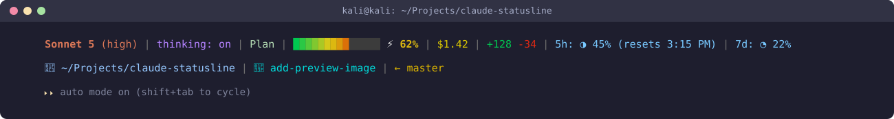
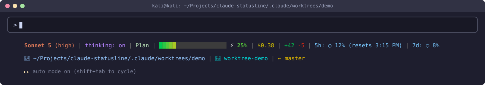
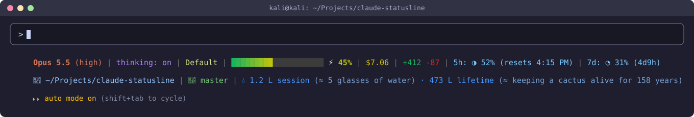

# claude-statusline

A custom two-line truecolor statusline for [Claude Code](https://claude.com/claude-code), plus
one-command installers for Linux, macOS, and Windows.

## What it shows

**Line 1:** model + effort · thinking mode · output style · context-usage bar · session cost ·
code velocity (+added/-removed) · 5-hour rate limit (with local reset time) · 7-day rate limit
(with a countdown to reset, e.g. `6d14h`)

**Line 2:** current directory · current git branch (or, in a worktree session, the worktree name
and its original branch) · optional estimated water usage (see
[Optional: water usage](#optional-water-usage))

### Normal session, early on (low context usage)



### Inside a Claude Code worktree session, deep into a session (high context usage)



When a session uses Claude Code's worktree-isolation feature (the `EnterWorktree` tool — an
isolated checkout on its own branch, used for parallel/experimental work), line 2 swaps the plain
branch name for the worktree's name and the branch it originally forked from.

## Install

**Linux / macOS**
```sh
git clone https://github.com/GoSlowPoke168/claude-statusline.git
cd claude-statusline
./install.sh
```

**Windows**
```powershell
git clone https://github.com/GoSlowPoke168/claude-statusline.git
cd claude-statusline
powershell -ExecutionPolicy Bypass -File install.ps1
```
Uses a native PowerShell port of the script — no Git for Windows, `bash.exe`, or `jq` required.
Only `git.exe` is needed, and only for the branch segment; everything else works without it.

**Running Claude Code inside WSL instead of natively?** Use the Linux instructions above from
inside your WSL distro.

Restart Claude Code (or start a new session) after installing, either way.

### Optional: water usage



Add any of these flags to append an estimated water footprint to line 2; re-run without them to
turn it off. The segment is column-aware: it reads the terminal width Claude Code passes in
`$COLUMNS` and picks fun facts that fit the space left, falling back to shorter facts, one fact,
no facts, then just the amounts as the window narrows.

**Linux / macOS**
```sh
./install.sh --water-session --water-lifetime --water-fun-fact
```

**Windows**
```powershell
powershell -ExecutionPolicy Bypass -File install.ps1 -WaterSession -WaterLifetime -WaterFunFact
```

| Linux / macOS | Windows | Shows |
|---|---|---|
| `--water-session` | `-WaterSession` | water used this session |
| `--water-lifetime` | `-WaterLifetime` | all-time water, from the same token history `/stats` uses |
| `--water-fun-fact` | `-WaterFunFact` | a rotating comparison after each value, e.g. `(≈ a faucet dripping for 15 days)` |

#### How the water is calculated

```
water (mL) = cost ($) × 170 mL/$
  170 mL/$ ≈ 40 Wh/$ × 4.2 mL/Wh
  4.2 mL/Wh = 0.55 L/kWh (data-center cooling) + 1.17 PUE × 3.14 L/kWh (power-plant water)
```

- **Energy:** ≈40 Wh per list-price dollar, from
  [Epoch AI-based estimates](https://simonpcouch.com/blog/2026-01-20-cc-impact/); Anthropic doesn't
  publish energy figures, and cost tracks compute (cache reads are cheap, output is expensive).
- **Water:** US-average on-site cooling plus power-plant water per kWh, per
  [Li et al.](https://arxiv.org/abs/2304.03271).
- **Session:** Claude Code's own `cost.total_cost_usd`.
- **Lifetime:** `/stats`'s token history priced at the official rates in `water-prices.txt`
  (input, output, 1-hour cache writes, cache reads, $0.01 per web search), plus the current session.
  Models missing from that file are priced from Claude Code's own recorded costs, refreshed at most
  daily.

It's a rough, for-fun number (real values vary several-fold by data center and model);
comparisons live in `water-facts.txt`.

## What the installer does

1. Copies the statusline script (`statusline-command.sh` or `.ps1`) to `~/.claude/` (or
   `$CLAUDE_CONFIG_DIR` if you've set that env var), plus `water.sh`/`water.ps1`,
   `water-facts.txt` and `water-prices.txt` only if a water flag is used (otherwise it removes them).
2. **Linux/macOS only:** makes sure `jq` is installed, via your platform's package manager if
   it's missing (`apt`/`dnf`/`yum`/`pacman`/`zypper`/`brew`).
3. Merges a `statusLine` key into `settings.json` — it only touches that one key, so any other
   settings you already have are left alone.

## Requirements

- **Linux/macOS:** bash, jq (auto-installed if missing).
- **Windows:** nothing beyond PowerShell itself (built into every Windows install). `git.exe`
  is only needed for the branch segment to resolve — install it however you like (Git for
  Windows, winget, scoop, etc.), bash is never invoked.

## Notes

- The bash version uses GNU `date -d`, with a fallback to BSD `date -r` for macOS, to render
  local rate-limit reset times.
- The context-usage segment has a commented-out `(used/max token count)` sub-feature — e.g.
  `(116k/1M)` next to the percentage. It's disabled by default; uncomment the block in both
  scripts (search for "Token count") to turn it back on.
- To customize colors or layout, edit `statusline-command.sh` (Linux/macOS) or
  `statusline-command.ps1` (Windows) directly, then re-run the installer to redeploy it.
- The two scripts are kept in sync by hand — if you change one, mirror the change in the other.

## Support the Project
If you find this plugin useful, please leave a star on GitHub or consider supporting its development!

[](https://ko-fi.com/T5T725W4FX)
